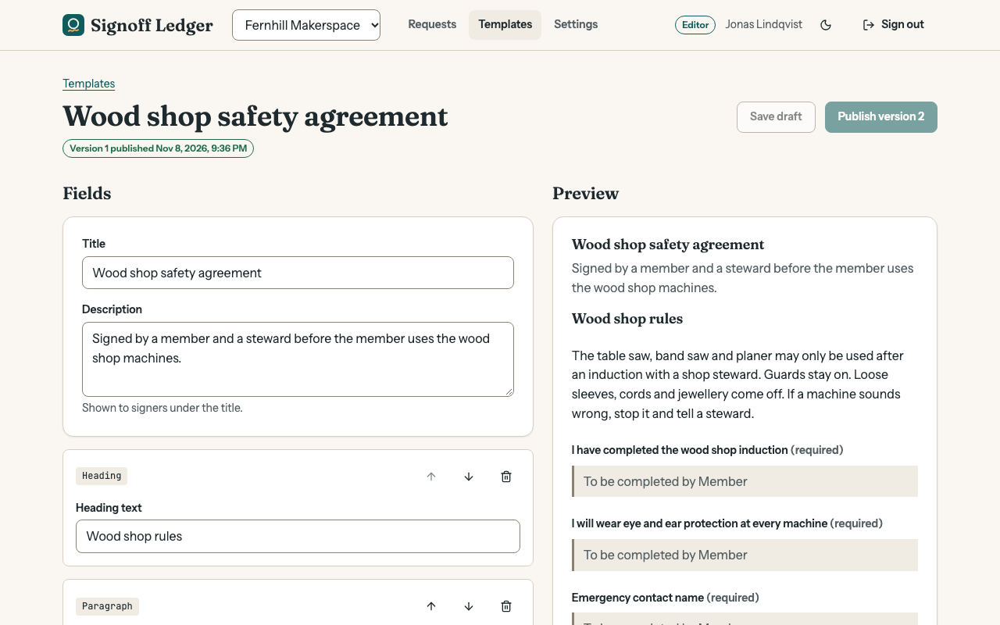

# Signoff Ledger

Versioned agreement templates and tamper-evident sign-offs for a fictional community makerspace.

[](https://github.com/Nawfaldev19/hashchain-esign/actions/workflows/ci.yml)
[](LICENSE)



> **About this screenshot.** It shows the seeded demo data. To take it again after a
> design change: run `npm run demo`, open <http://localhost:4000>, choose "Continue
> as editor", open **Templates → Wood shop safety agreement**, set the browser window
> to 1280 × 800, and save the visible page as `docs/screenshots/builder.png`.

Signoff Ledger is a portfolio demo, not a product. Everything in it is fictional: the
makerspaces, the people and the agreements.

## What this demonstrates

1. **Tenant isolation enforced by the database.** Postgres row-level security and
   two restricted roles fence every query into one workspace, so a missing `WHERE`
   in application code cannot leak data. See
   [`src/server/db/migrations.ts`](src/server/db/migrations.ts) and
   [`src/server/db/database.ts`](src/server/db/database.ts), proven by
   [`tests/integration/tenant-isolation.test.ts`](tests/integration/tenant-isolation.test.ts).
2. **An immutable, versioned document model.** Drafts are edited with optimistic
   locking; publishing freezes a numbered version that requests point at. See
   [`src/server/services/template-service.ts`](src/server/services/template-service.ts).
3. **A tamper-evident audit trail.** Each event stores the hash of the one before,
   and each signature's content is fingerprinted into the chain. See
   [`src/server/domain/history.ts`](src/server/domain/history.ts) and
   [`src/server/services/event-log.ts`](src/server/services/event-log.ts).
4. **A public, account-free flow with real security properties.** Signing links are
   random tokens stored only as hashes, they expire, can be revoked and replaced, and
   concurrent submissions are resolved in the database. See
   [`src/server/services/signing-service.ts`](src/server/services/signing-service.ts).
5. **A typed API from schema to screen.** A code-first GraphQL schema, with operation
   types inferred by the compiler on the client. See
   [`src/server/graphql/types.ts`](src/server/graphql/types.ts) and
   [`src/web/graphql/operations.ts`](src/web/graphql/operations.ts).
6. **An accessible interface built on design tokens.** A keyboard-usable template
   builder, a pointer-driven signature pad with a typed alternative, light and dark
   themes, and contrast that is computed in a test. See
   [`src/web/styles/tokens.css`](src/web/styles/tokens.css),
   [`src/web/features/templates/`](src/web/features/templates/) and
   [`tests/unit/design-tokens.test.ts`](tests/unit/design-tokens.test.ts).

## Quick start

You need [Node.js](https://nodejs.org) 20.19 or newer. Nothing else: the database is
embedded.

```bash
npm install
npm run demo
```

Then open <http://localhost:4000>. The start page explains the demo and signs you in
with one click.

| Demo account | Email               | Password          | Can                                               |
| ------------ | ------------------- | ----------------- | ------------------------------------------------- |
| Owner        | `mira@example.com`  | `makerspace-demo` | Everything, and is a viewer in a second workspace |
| Editor       | `jonas@example.com` | `makerspace-demo` | Edit templates, send and revoke requests          |
| Viewer       | `priya@example.com` | `makerspace-demo` | Read only                                         |

To try the public signing page: sign in as the editor, open the request **Print room
hire, Saturday**, press **New link**, and open the link in a private window.

The demo data lives in `.data/`. Delete that folder to start again from fresh seed
data.

### Other commands

| Command                     | What it does                                                                              |
| --------------------------- | ----------------------------------------------------------------------------------------- |
| `npm run dev`               | API with reload on port 4000 and the web app with hot reload on port 5173                 |
| `npm run check`             | Lint, type check, unit, integration and component tests with coverage, then build         |
| `npm run test:e2e`          | Browser tests against the production build (first run: `npx playwright install chromium`) |
| `npm run codegen`           | Rewrite `schema.graphql` and the client's schema types after an API change                |
| `docker compose up --build` | Run the production build in a container on port 4000                                      |

If Playwright has no browser build for your operating system, run the browser tests
with an installed Chrome instead: `PW_CHANNEL=chrome npm run test:e2e`.

## Tech stack

| Choice                                    | Why                                                                                                 |
| ----------------------------------------- | --------------------------------------------------------------------------------------------------- |
| TypeScript, strict mode                   | One language and one set of types from the database edge to the browser                             |
| PGlite (Postgres compiled to WebAssembly) | Real row-level security, constraints and triggers with no database to install                       |
| GraphQL Yoga with Pothos                  | A schema written in TypeScript, so resolvers are checked against the service types                  |
| React 19 with React Router                | Plain client-rendered pages are enough here; no server rendering to explain                         |
| urql with gql.tada                        | A small GraphQL client, with result types inferred from the schema and no generated operation files |
| Plain CSS with custom properties          | The design tokens stay visible, and the licence list stays short                                    |
| pdf-lib                                   | Builds the signed copy on the server without a headless browser                                     |
| Zod                                       | Validates every input at the API edge and the environment at start-up                               |
| Vitest, Testing Library, Playwright       | One fast runner for unit, integration and component tests; real browsers for the journeys           |

## Documentation

- [Plan](docs/PLAN.md): goals, scope and the order the work was done in
- [Architecture](docs/ARCHITECTURE.md): the parts, the data model, the tenancy model and the main flows
- [Decisions](docs/DECISIONS.md): ten architecture decision records with the alternatives that were rejected
- [Testing](docs/TESTING.md): what each test layer covers, coverage numbers and known gaps
- [Security](docs/SECURITY.md): threat model, controls, and what is deliberately not covered
- [References](docs/REFERENCES.md): specifications, documentation and books behind the patterns used

## Scope and limitations

Stated plainly, so nothing here is mistaken for more than it is:

- **Not a legal e-signature service.** There is no identity verification, no
  certificate-based signing and no legal review. The history proves that records were
  not changed afterwards; it does not prove who held the pen.
- **No email is sent.** Signing links are shown to staff, who pass them on. A real
  system would deliver them and would not show them on screen.
- **One process, one connection.** The embedded database runs inside the server
  process and handles one transaction at a time. That is fine for a demo and is the
  first thing to change for real load (see ADR 2).
- **Rate limits are in memory.** They reset on restart and are not shared between
  processes.
- **PDF text is Latin only.** The standard PDF fonts cannot draw other scripts, so
  such characters appear as `?` in the PDF. The stored answer is unchanged.
- **No member management screen.** Members and roles come from the seed data.
- **Drawing needs a pointer.** The signature pad cannot be used from the keyboard;
  typing your name is always offered beside it.
- **The container setup is not covered by CI.** `Dockerfile` and `docker-compose.yml`
  are provided for convenience; `npm run demo` is the tested path.

## Author

Nawfal Imran · [GitHub](https://github.com/Nawfaldev19) · [LinkedIn](https://www.linkedin.com/in/nawfal-imran-886b13218)

## License

[MIT](LICENSE). Third-party packages and fonts are listed in
[THIRD_PARTY_NOTICES.md](THIRD_PARTY_NOTICES.md).
