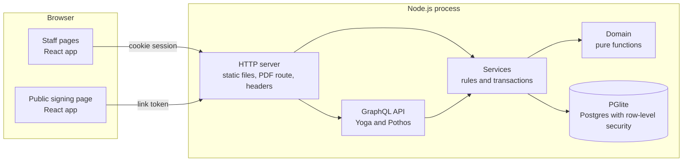
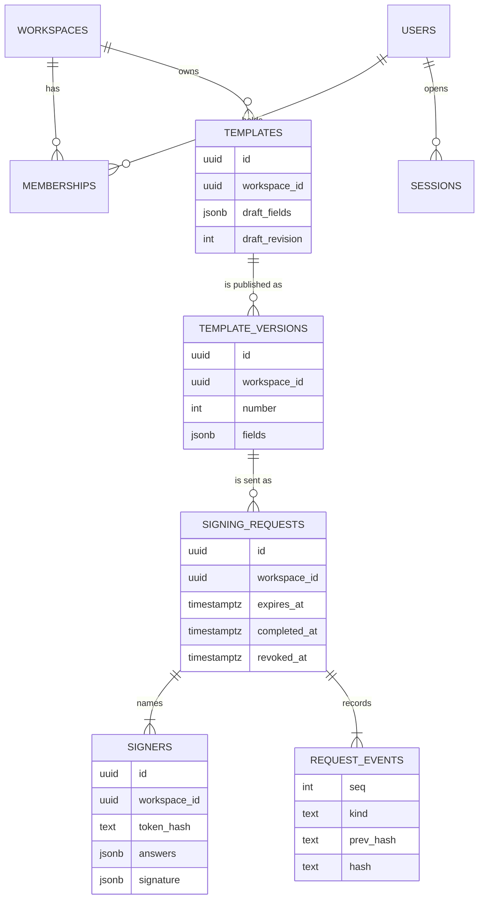
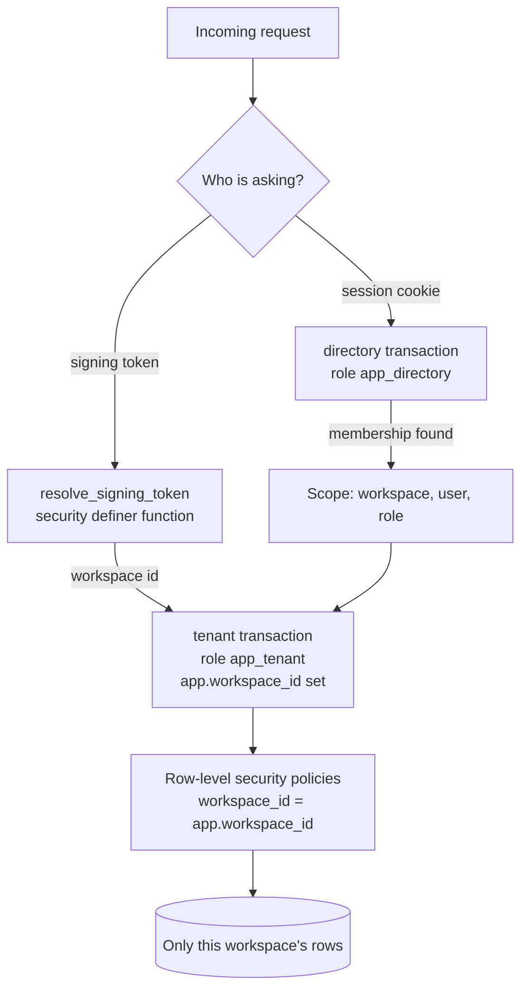
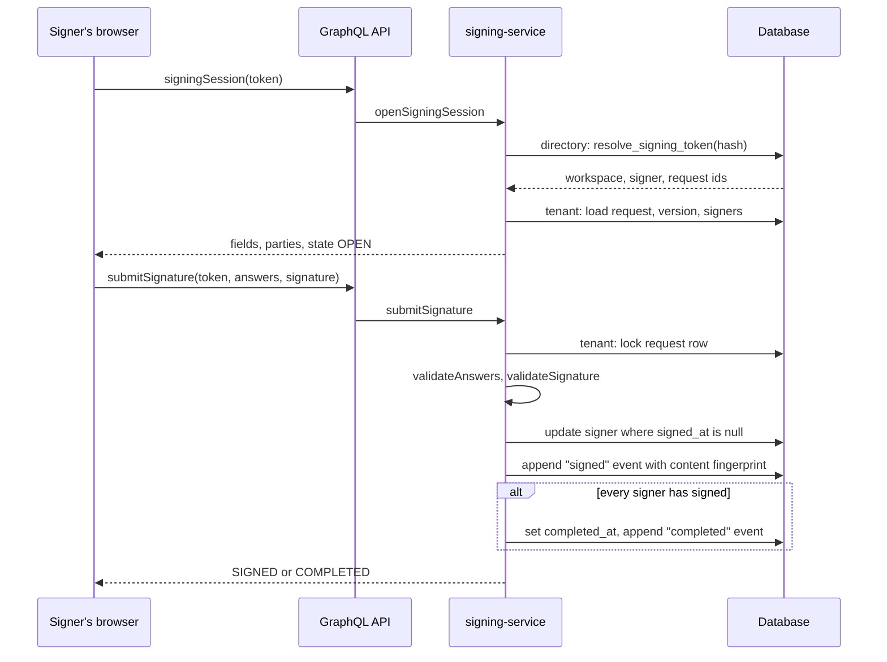

# Architecture

## The parts

Signoff Ledger is one Node.js process. It serves the built web app as static files,
answers a GraphQL API, renders PDFs, and holds an embedded Postgres database.



## Layers and their rules

| Layer    | Folder                | May depend on    | Knows about                                                                             |
| -------- | --------------------- | ---------------- | --------------------------------------------------------------------------------------- |
| Shared   | `src/shared`          | nothing          | The field model, answer validation, status rules. Runs in the browser and on the server |
| Domain   | `src/server/domain`   | shared           | Hashing, tokens, cursors, rate limits, errors. No database, no HTTP                     |
| Database | `src/server/db`       | domain           | The schema, policies, and the three ways to open a transaction                          |
| Services | `src/server/services` | all of the above | Use cases. Each function takes its dependencies and a `Scope`                           |
| API      | `src/server/graphql`  | services         | Types, arguments, batching. No business rules                                           |
| HTTP     | `src/server/http`     | services, API    | Routing, headers, the PDF download                                                      |
| Web      | `src/web`             | shared           | Pages and components. Talks to the server only through GraphQL                          |

Two rules keep this honest:

- **Rules live in one place.** `validateAnswers` in `src/shared/fields.ts` is the only
  definition of a valid submission. The signing page calls it to give fast feedback;
  the server calls the same function and is the authority.
- **Dependencies are passed in.** Services receive a `Deps` object (database, clock,
  rate limiters). Tests replace the clock to test expiry without waiting.

## Data model



Points worth noticing:

- **Fields are stored as JSON, not as rows.** A template version is read and written
  as a whole and never queried by field, so one `jsonb` column is simpler and makes a
  version trivially immutable. The shape is validated on the way in.
- **Every tenant table carries `workspace_id`**, and child tables reference their
  parent by `(workspace_id, id)`. The database itself refuses a signer that points at
  another workspace's request.
- **Status is not a column.** It is derived from `revoked_at`, `completed_at`,
  `expires_at` and the signer rows by `deriveRequestStatus`, so it cannot disagree
  with them. List filters use the same rules in SQL.
- **Two tables are append-only.** Triggers reject `UPDATE` and `DELETE` on
  `template_versions` and `request_events`.

## Tenancy model



The server never queries tenant data as the database owner. `Database` offers three
doors (`src/server/db/database.ts`):

- `tenant(workspaceId, work)` opens a transaction, switches to the `app_tenant` role
  and sets `app.workspace_id`. Policies then limit every statement to that workspace.
  If the setting is missing, the policies match nothing, so a mistake fails closed.
- `directory(work)` switches to `app_directory`, which can read users, memberships
  and sessions but has no access at all to templates, requests, signers or events.
- `admin` is the owner connection, used by migrations, the seed script and tests.

A signing link is the one case where the workspace is unknown at the start. A single
`SECURITY DEFINER` function maps a token hash to ids and returns nothing else. That
is the only code path that reads across workspaces, and it is a few lines of SQL.

The API adds a second, independent layer: `requireScope` checks membership and role
before any service runs, and answers `NOT_FOUND` (not `FORBIDDEN`) for a workspace
the caller is not in, so ids cannot be probed.

## Main flow: signing



Locking the request row first makes signers of the same request take turns, and the
conditional update makes a double submit lose cleanly. Both cases have tests.

## The history chain

Each event stores `prev_hash` and `hash = SHA-256(canonical JSON of the event and
prev_hash)`. The first event links to a fixed all-zero hash. Changing, removing or
reordering any event breaks every hash after it, and `verifyChain` reports the first
sequence number that does not fit.

The chain alone would only protect the events. So the "signed" event also stores a
fingerprint of the signer's answers and signature, and `verifyHistory` recomputes it
from the signer row. Editing a stored answer later is therefore detected as well.

The chain proves the records are internally consistent. It does not stop someone who
controls the database from rebuilding the whole chain; that needs an anchor outside
the system, which is noted in the security document.

## Performance reasoning

- **Keyset pagination.** Lists page by `(created_at, id) < cursor` on a matching
  index, so page 500 costs the same as page 1 and inserts do not shift pages.
  Timestamps are stored at millisecond precision because that is what a JavaScript
  date, and therefore a cursor, can hold; finer precision would make rows fall
  between pages.
- **No N+1 queries.** A list of signing requests needs the signers and the version of
  each one. DataLoaders, created fresh for every HTTP call, batch these into one
  query each, whatever the page size.
  Signer counts come from correlated subqueries in the list query itself.
- **Small payloads.** A drawn signature is a list of points as fractions of the box
  (a few kilobytes), not an image.
- **Static assets** carry content hashes and are served with a one-year immutable
  cache header; `index.html` is always revalidated.
- **Known ceiling.** PGlite runs one transaction at a time in the server process.
  Everything is written against plain SQL and three small methods, so moving to a
  Postgres server with a connection pool changes one file (see ADR 2).

## Error handling

Services throw `AppError` with a stable code (`NOT_FOUND`, `FORBIDDEN`, `VALIDATION`,
`CONFLICT`, `UNAUTHENTICATED`, `RATE_LIMITED`) and, for validation, a list of issues
with field ids. The API passes these to the client in `extensions`. Any other error
is treated as a bug: it is logged in full as structured JSON, and the client is told
only that something went wrong. The web app turns codes into specific messages and
puts field issues next to the fields they belong to.

## Web app structure

```
src/web
  styles/       tokens.css (design tokens), base.css, components.css
  graphql/      the typed client and every operation, in one file
  lib/          error reading, API-to-model mapping, formatting, theme
  components/   presentation only: buttons, fields, dialog, signature pad, document
  features/     one folder per screen area: auth, shell, landing, templates,
                requests, settings, signing
```

`DocumentForm` renders a template version three ways with the same code: as the
builder's live preview, as the public signing form, and as the read-only signed copy.
What an editor previews is therefore what a signer gets.

The template builder keeps its working copy in a reducer
(`features/templates/builder-state.ts`). All editing rules are pure functions there,
tested without rendering anything.
